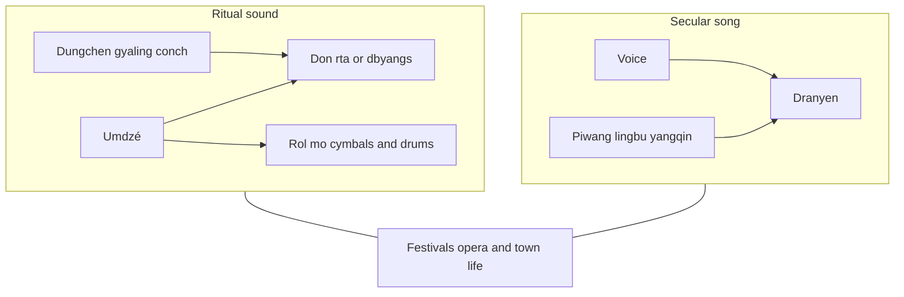

# Start here

Pick the job. Open that note. The cheatsheets are the one-page versions.

| Job | Open |
| --- | --- |
| See the whole map | [[Overview map]] and [[Home]] |
| Learn the three kinds of chant | [[How the music is organized]] and [[Vocal styles]] |
| Learn the folk scale | [[Scales and pentatonic modes]] and [[Scales cheatsheet]] |
| Tune a dranyen | [[Dranyen]] |
| Name the instruments in a recording | [[Instruments cheatsheet]] and [[Sound map]] |
| Understand Gyuto "chord" singing | [[Overtone chant]] |
| Follow an opera | [[Ache Lhamo]] |
| Follow a masked dance | [[Cham]] |
| Separate regions | [[Regions]] |
| Read notation | [[Yang notation]] |
| Check a claim about bowls or altitude | [[What is not Tibetan music]] and [[Altitude voice and hearing]] |
| Find a recording | [[Listening map]] |
| Look up a word | [[Glossary]] |
| See who argued what | [[Sources]] and [[Lineages and people]] |

## The one diagram

The ritual side thinks in contour, text, and counted cymbal patterns. The secular side thinks in a movable do and, in Central Tibet, five pentatonic homes. A recording usually belongs to one side. [[Ache Lhamo]] is the main place a listener meets both, and even there the old accompaniment is drum and cymbals alone.

## How to read a claim in this vault

Each technical note ends with the works it depends on. Those works are listed in full in [[Sources]].

Three habits of the literature matter:

- Monastery practice is lineage-specific. Gyuto is not Gyume. Sakya notation is not Gelug notation.
- "Tibetan" in a shop or a streaming playlist often means a Western product. [[What is not Tibetan music]] is the filter.
- Absolute pitch is rarely the point. Degrees, contours, and who leads the ensemble are the point. See [[Pitch tuning and intervals]].
